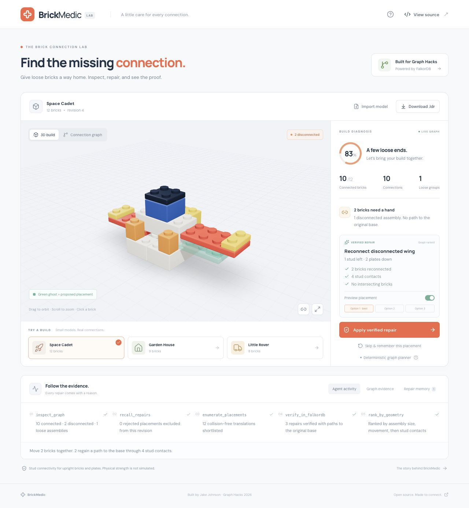
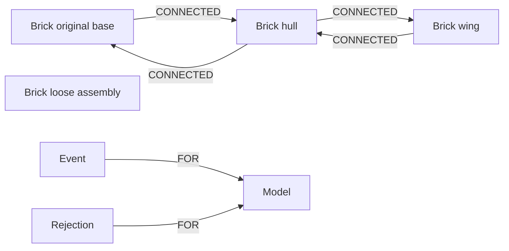

# BrickMedic

**Find the missing connection.** A FalkorDB-powered repair agent that finds disconnected brick assemblies, previews a repair, and verifies the result with graph queries.

Built by Jake Johnson for [Graph Hacks 2026](https://www.wemakedevs.org/hackathons/falkordb). Primary entry: **Track 1 — Agents That Act on Connected Data**. Persistent repair memory also demonstrates part of Track 2; the prototype uses one planner rather than a team of agents.



- Inspect three synthetic demo builds in an interactive 3D viewer or a connection graph.
- Find every brick that has no path to the original base.
- Test rigid translations of loose assemblies, with collision checks and trial graphs.
- Preview up to three verified options, apply one, and query the repaired graph again.
- Remember skipped placements and repair history in FalkorDB.
- Import supported LDraw `.ldr` or BrickMedic JSON; download the current model as LDraw.
- Optionally use Anthropic to select among verified repairs. The default graph planner requires no AI key.

**[Read the build post](docs/blog-post.md)** · **[Watch the demo](docs/brickmedic-demo.mp4)** · **[Submission details](docs/submission.md)**

## Run locally

Requirements: **Node.js 24 LTS**, npm, and Docker with Docker Compose v2. Node 22.14+ LTS is also supported. The app binds to loopback by default.

```bash
git clone --branch feat/brickmedic-hackathon https://github.com/jjohnson5253/brickmedic.git
cd brickmedic
npm ci
cp .env.example .env
npm run db:up
npm run dev
```

Open **http://127.0.0.1:4317**. FalkorDB is available only on `127.0.0.1:6387`. The API listens on `127.0.0.1:4318`; Vite proxies `/api` to it. Docker Compose pins the tested FalkorDB image by digest and stores its data in a named volume.

For the production build locally:

```bash
npm run build
npm start
```

Then open **http://127.0.0.1:4318**. This also serves the formatted blog at `/blog.html`. Complete local setup and a demo are supplied for the hackathon; a public hosted application is not included.

Use `npm run db:down` to stop FalkorDB while preserving its named volume. Restart it with `npm run db:up`. Restart the API after changing environment variables.

### Optional AI selection

Set your own server-side key in the ignored `.env` file:

```dotenv
ANTHROPIC_API_KEY=your-key
ANTHROPIC_MODEL=claude-haiku-5-5
```

The AI receives the model name and candidate evidence, chooses a verified candidate ID, and supplies a short explanation. Coordinates and Cypher are never executed from its response. The server checks the candidate ID and revalidates the geometry and graph before applying it. API failures are displayed explicitly.

Without a key, the UI says **Deterministic graph planner**. This mode runs the same graph queries, placement search, trial graphs, and final validation. The submitted screenshots and video use deterministic mode. The AI integration was tested with controlled chooser implementations; a live Anthropic call has not been verified.

Only synthetic demo data ships with the project. Use data you are permitted to use, and follow the hackathon's restrictions on personal and restricted information. Enabling AI sends the model name and repair evidence to Anthropic.

## The graph data model

Each visitor gets an unguessable, cookie-scoped FalkorDB graph. The graph stores the complete current model, connection topology, active plan, rejected placement fingerprints, and repair history. The browser stores only an HttpOnly session cookie.



| Entity      | Properties and purpose                                                                                     |
| ----------- | ---------------------------------------------------------------------------------------------------------- |
| `Model`     | JSON snapshot, original anchor IDs, revision, and current plan                                             |
| `Brick`     | Stable ID, part, color, position, dimensions, label, original-root flag                                    |
| `CONNECTED` | One directed relationship in each direction per physical stud contact, with the number of contacting studs |
| `Event`     | Load, apply, or reject event, timestamp, and explanation; linked to `Model`                                |
| `Rejection` | Placement fingerprint and model revision; linked to `Model`                                                |

The 3D view is generated from server-returned model state. Its status and connection lines come from FalkorDB analysis, not browser-side connectivity inference. Removing FalkorDB stops inspection, planning, applying repairs, and repair memory.

### Queries the product depends on

Executable Cypher is in [`src/server/queries.ts`](src/server/queries.ts). User values are supplied as query parameters.

Reachable bricks:

```cypher
MATCH (root:Brick {root: true})-[:CONNECTED*0..100]->(b:Brick)
RETURN DISTINCT b.id AS id ORDER BY id
```

A complete loose assembly:

```cypher
MATCH (start:Brick {id: $id})-[:CONNECTED*0..100]->(b:Brick)
RETURN DISTINCT b.id AS id ORDER BY id
```

A shortest connection path:

```cypher
MATCH (b:Brick {id: $id}), (root:Brick {root: true})
WITH shortestPath((b)-[:CONNECTED*0..100]->(root)) AS path
WHERE path IS NOT NULL
WITH path ORDER BY length(path) LIMIT 1
RETURN [n IN nodes(path) | n.id] AS path
```

Each candidate is written into an isolated temporary graph, analyzed with the same queries, and deleted in a `finally` block. Applying a candidate repeats validation and updates the current graph with one Cypher write. Per-session serialization and revision checks block concurrent or stale apply requests. The server currently supports a **single API process**; shared locking would be needed before running multiple replicas.

### Repair search

1. Determine anchored and disconnected bricks from FalkorDB.
2. Traverse each disconnected component as one rigid assembly.
3. Enumerate stud-aligned translations that contact anchored bricks.
4. Exclude remembered rejections, intersections, out-of-bounds placements, and moves greater than 8 horizontal studs or 9 vertical plate units.
5. Shortlist at most 12 placements by assembly size, movement, then contact count.
6. Verify proposals in trial graphs and return up to 3 valid repairs.
7. Rank deterministically, or let the configured AI chooser select a verified option.
8. After user application, verify again and record the repair.

Original anchors remain fixed. A moved brick touching the floor does not become a new anchor. Failure to find a repair means the bounded search found none, not that the model is irreparable.

## Supported geometry and imports

Coordinates use studs for `x` and `z`, and plate units for vertical `y`. A standard brick is three plate units high. `x` and `z` describe the minimum corner of a brick footprint; `y` is its underside. Values must be integers.

- Up to 100 bricks and a 100 KB import payload.
- Start coordinates: `x,z` in −40…40 and `y` in 0…60.
- Upright rectangular parts only; vertical quarter turns are supported.
- At least one brick must start on the base plane. LDraw imports normalize their lowest underside to that plane.
- Imports reject collisions, unsupported parts, tilted transforms, submodels, non-finite values, and off-grid placements.

| Parts                                                 | Dimensions in studs                 |
| ----------------------------------------------------- | ----------------------------------- |
| Bricks `3001`, `3002`, `3003`, `3004`, `3005`, `3010` | 2×4, 2×3, 2×2, 1×2, 1×1, 1×4        |
| Plates `3020`, `3021`, `3022`, `3023`, `3024`, `3710` | Same six footprints; one plate high |

The color palette is explicitly defined in [`src/shared/model.ts`](src/shared/model.ts). Flat `.ldr` files must contain supported type 1 references and comments; unsupported geometry is rejected, rather than silently dropped. Example `.ldr` and `.json` files are in [`public/models`](public/models).

**Scope:** BrickMedic checks stud connectivity. It does not simulate clutch strength, stress, gravity, center of mass, legal assembly order, hinges, slopes, Technic connectors, or the full LEGO parts catalog. The colored geometry in the viewer is a simplified procedural representation. LEGO is a trademark of the LEGO Group; this project is independent.

## Validate

```bash
npm test
npm run db:up
npm run test:integration
npm run build
npm audit --audit-level=moderate
```

There are 21 unit tests and 11 integration tests. Integration tests require a real FalkorDB at `FALKORDB_URL` and use isolated test graphs that are deleted afterward. They cover all three demo repairs, persistence across a client reconnect, remembered rejections, session isolation, repeated applies, HTTP boundaries, exports, and temporary-graph cleanup. No test calls a paid AI API.

Desktop and phone layouts were checked in the browser, including the 3D build, repair preview, application, and connection graph. GitHub Actions runs tests, a production build, and the dependency audit. Validation details and the demo script are in [`docs/submission.md`](docs/submission.md).

## Project layout

```text
src/client/       React, Three.js, and graph evidence UI
src/server/       Express API, geometry, graph store, planner, LDraw import/export
src/shared/       Validated model schema and API types
tests/           Unit and real-FalkorDB integration tests
docs/            Build post, submission notes, screenshots, and demo
public/models/   Synthetic JSON and LDraw sample models
```

Optional PostHog interaction events use a user-supplied `VITE_POSTHOG_KEY`; analytics is disabled by default. Autocapture, page tracking, and session recording are disabled. Events omit model contents, labels, filenames, and session IDs. Fonts are bundled with their SIL Open Font Licenses.

The default app is intended for local use. Before exposing it on a public host, add user authentication, HTTPS with `SECURE_COOKIES=true`, graph retention controls, and a `PUBLIC_ORIGIN` matching that host. Credentials belong only in server environment variables; `.env` files are ignored.

## AI assistance and license

Codex assisted with code, tests, documentation, the demo walkthrough, and the blog post. The participant must review and understand the graph model, queries, and implementation before submitting. The main BrickMedic implementation was created during the October 15–18, 2026 event window.

MIT licensed. Fonts retain their accompanying licenses. All included demo models are synthetic, authored for this project.
