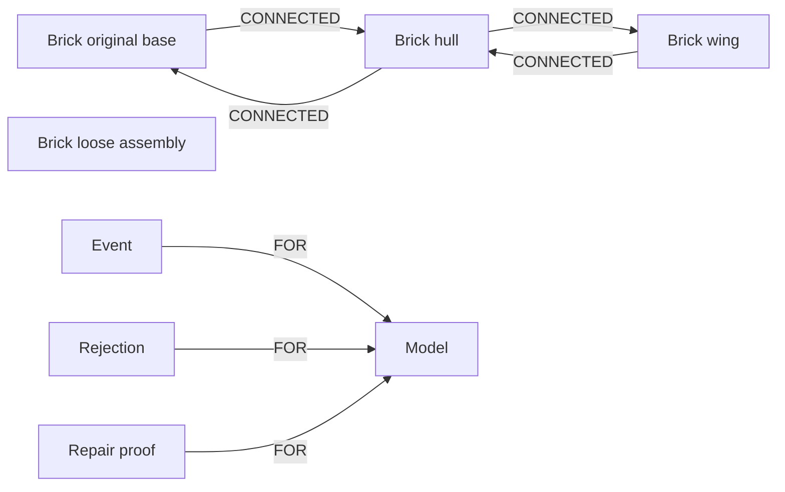

# BrickMedic

**Find the missing connection.** A graph repair lab and MCP tool server that lets AI agents find disconnected brick assemblies, test repairs, and return replayable evidence.

Built by Jake Johnson for [Graph Hacks 2026](https://www.wemakedevs.org/hackathons/falkordb). Submitted as a solo entry on October 17, 2026 in **Track 1 — Agents That Act on Connected Data** and **Track 2 — Agent Memory and Coordination**. Track 2 demonstrates persistent repair memory and a handoff between fresh MCP clients.


- Inspect three synthetic demo builds in an interactive 3D viewer or a connection graph.
- Find every brick that has no path to the original base.
- Test rigid translations of loose assemblies, with collision checks and trial graphs.
- Preview up to three verified options, apply one, and query the repaired graph again.
- Remember skipped placements and repair history in FalkorDB, including across MCP client handoffs.
- Ask what disconnects if a brick is removed, using a disposable counterfactual graph.
- Download repair proofs with before/after models, SHA-256 hashes, fixed anchors and paths; independently replay them against FalkorDB.
- Connect any compatible AI host through eight typed MCP tools. Applying repairs requires startup opt-in and host approval.
- Import supported LDraw `.ldr` or BrickMedic JSON; download the current model as LDraw.
- Optionally use Anthropic to select among verified repairs. The default graph planner requires no AI key.

**[Read the published build post](https://jjohnson5253.github.io/brickmedic/)** · **[Narrated walkthrough](docs/brickmedic-demo.mp4)** · **[YouTube demo](https://youtu.be/5bnvr_zqBGQ)** · **[Submission details and receipt](docs/submission.md)**

## Evidence in three minutes

**35/35 synthetic cases repaired · 114/114 repair proofs independently replayed · all original anchors preserved.** These results come from the deterministic planner against real FalkorDB, not a model-generated assessment. The dataset contains the three demos plus 32 seeded generated tower builds; it is not a real-world or held-out benchmark.

- [Machine-readable evaluation and per-case results](docs/evidence/evaluation.json)
- [A complete before/after repair proof](docs/evidence/repair-proof.json)
- [MCP setup, tool reference and handoff walkthrough](docs/agent-tools.md)

After installing dependencies and starting FalkorDB, reproduce the results with `npm run evaluate`. Independently check the committed example with `npm run verify -- docs/evidence/repair-proof.json`. Both commands fail on invalid evidence; neither calls a paid model API.

## Run locally

Requirements: **Node.js 24 LTS**, npm, and Docker with Docker Compose v2. Node 22.14+ LTS is also supported. The app binds to loopback by default.

```bash
git clone https://github.com/jjohnson5253/brickmedic.git
cd brickmedic
npm ci
cp .env.example .env
npm run db:up
npm run dev
```

Open **http://127.0.0.1:4317**. FalkorDB is available only on `127.0.0.1:6387`. The API listens on `127.0.0.1:4318`; Vite proxies `/api` to it. Docker Compose pins the tested FalkorDB image by digest and stores its data in a named volume.

For the production build locally:

```bash
npm run build
npm start
```

Then open **http://127.0.0.1:4318**. This also serves the formatted blog at `/blog.html`. Complete local setup and a demo are supplied for the hackathon; a public hosted application is not included.

Use `npm run db:down` to stop FalkorDB while preserving its named volume. Restart it with `npm run db:up`. Restart the API after changing environment variables.

### Optional AI selection

Set your own server-side key in the ignored `.env` file:

```dotenv
ANTHROPIC_API_KEY=your-key
ANTHROPIC_MODEL=claude-haiku-5-5
```

The AI receives the model name and candidate evidence, chooses a verified candidate ID, and supplies a short explanation. Coordinates and Cypher are never executed from its response. The server checks the candidate ID and revalidates the geometry and graph before applying it. API failures are displayed explicitly.

Without a key, the UI says **Deterministic graph planner**. This mode runs the same graph queries, placement search, trial graphs, and final validation. The submitted screenshots and video use deterministic mode. The AI integration was tested with controlled chooser implementations; a live Anthropic call has not been verified.

Only synthetic demo data ships with the project. Use data you are permitted to use, and follow the hackathon's restrictions on personal and restricted information. Enabling AI sends the model name and repair evidence to Anthropic.

## Connect an AI agent

`npm run mcp` starts a local stdio MCP server using the official TypeScript SDK. An AI host can inspect the model, request verified repairs, test removal impact, recall memory and reject a placement. The server owns the session scope; tool arguments cannot select another tenant or execute arbitrary Cypher.

`apply_repair` is disabled unless the owner sets `BRICKMEDIC_ALLOW_APPLY=true`. The host should ask the user to approve applying the selected repair. Every application still requires a current candidate UUID and revision and repeats validation. The MCP transport and a reconnecting-client handoff were tested end to end against real FalkorDB. The included evaluation uses a scripted client/planner, not an autonomous LLM run. External hosts bring their own model.

See [agent-tools.md](docs/agent-tools.md) for configuration and the eight tools. The optional Anthropic selector in the web app remains a separate, bounded chooser.

## The graph data model

The [durability check](docs/evidence/durability.json) also confirmed that model, revision, plan and rejection history survive replacing the Docker container. Compose enables append-only persistence in its named volume through the image’s supported environment settings.

Each visitor gets an unguessable, cookie-scoped FalkorDB graph. The graph stores the complete current model, connection topology, active plan, rejected placement fingerprints, and repair history. The browser stores only an HttpOnly session cookie.



| Entity      | Properties and purpose                                                                                                        |
| ----------- | ----------------------------------------------------------------------------------------------------------------------------- |
| `Model`     | JSON snapshot, original anchor IDs, revision, and current plan                                                                |
| `Brick`     | Stable ID, part, color, position, dimensions, label, original-root flag                                                       |
| `CONNECTED` | One directed relationship in each direction per physical stud contact, with the number of contacting studs                    |
| `Event`     | Load, apply, or reject event, timestamp, and explanation; linked to `Model`                                                   |
| `Rejection` | Placement fingerprint and model revision; linked to `Model`                                                                   |
| `Repair`    | Before/after hashes, revision and complete replayable proof; linked to `Model` and written atomically with the repaired model |

The 3D view is generated from server-returned model state. Its status and connection lines come from FalkorDB analysis, not browser-side connectivity inference. Removing FalkorDB stops inspection, planning, applying repairs, and repair memory.

### Queries the product depends on

Executable Cypher is in [`src/server/queries.ts`](src/server/queries.ts). User values are supplied as query parameters.

Reachable bricks:

```cypher
MATCH (root:Brick {root: true})-[:CONNECTED*0..100]->(b:Brick)
RETURN DISTINCT b.id AS id ORDER BY id
```

A complete loose assembly:

```cypher
MATCH (start:Brick {id: $id})-[:CONNECTED*0..100]->(b:Brick)
RETURN DISTINCT b.id AS id ORDER BY id
```

A shortest connection path:

```cypher
MATCH (b:Brick {id: $id}), (root:Brick {root: true})
WITH shortestPath((b)-[:CONNECTED*0..100]->(root)) AS path
WHERE path IS NOT NULL
WITH path ORDER BY length(path) LIMIT 1
RETURN [n IN nodes(path) | n.id] AS path
```

Each candidate is written into an isolated temporary graph, analyzed with the same queries, and deleted in a `finally` block. Applying a candidate repeats validation and updates the current graph with one Cypher write. Per-session serialization and revision checks block concurrent or stale apply requests. The server currently supports a **single API process**; shared locking would be needed before running multiple replicas.

### Repair search

1. Determine anchored and disconnected bricks from FalkorDB.
2. Traverse each disconnected component as one rigid assembly.
3. Enumerate stud-aligned translations that contact anchored bricks.
4. Exclude remembered rejections, intersections, out-of-bounds placements, and moves greater than 8 horizontal studs or 9 vertical plate units.
5. Shortlist at most 12 placements by assembly size, movement, then contact count.
6. Verify proposals in trial graphs and return up to 3 valid repairs.
7. Rank deterministically, or let the configured AI chooser select a verified option.
8. After user application, verify again and record the repair.

Original anchors remain fixed. A moved brick touching the floor does not become a new anchor. Failure to find a repair means the bounded search found none, not that the model is irreparable.

## Counterfactuals and portable proof

Select a brick in the 3D view or connection graph, then choose **What if I remove this brick?** The server copies the model into an isolated graph, deletes that brick, queries reachability again, and returns the other previously anchored bricks that lose all paths to the original base. It does not alter the live revision. This is a connectivity dependency test, not a physical strength prediction.

Applying a repair atomically stores the model and a `Repair` proof node. The proof includes both complete models, normalized SHA-256 hashes, original anchors, the rigid translation, revisions, connection counts and an actual base path. Download it from the app or retrieve it through `recall_memory`.

The verifier checks hashes, declared movement and fixed anchors, rebuilds both states in fresh FalkorDB graphs, then checks connection counts, preserved reachability and every reported path hop. It does not trust the stored counts. Hashes detect changed contents; they are not a signature or a claim of authorship. Proofs are scoped to the current loaded model and cleared when another model is loaded.

## Supported geometry and imports

Coordinates use studs for `x` and `z`, and plate units for vertical `y`. A standard brick is three plate units high. `x` and `z` describe the minimum corner of a brick footprint; `y` is its underside. Values must be integers.

- Up to 100 bricks and a 100 KB import payload.
- Start coordinates: `x,z` in −40…40 and `y` in 0…60.
- Upright rectangular parts only; vertical quarter turns are supported.
- At least one brick must start on the base plane. LDraw imports normalize their lowest underside to that plane.
- Imports reject collisions, unsupported parts, tilted transforms, submodels, non-finite values, and off-grid placements.

| Parts                                                 | Dimensions in studs                 |
| ----------------------------------------------------- | ----------------------------------- |
| Bricks `3001`, `3002`, `3003`, `3004`, `3005`, `3010` | 2×4, 2×3, 2×2, 1×2, 1×1, 1×4        |
| Plates `3020`, `3021`, `3022`, `3023`, `3024`, `3710` | Same six footprints; one plate high |

The color palette is explicitly defined in [`src/shared/model.ts`](src/shared/model.ts). Flat `.ldr` files must contain supported type 1 references and comments; unsupported geometry is rejected, rather than silently dropped. Example `.ldr` and `.json` files are in [`public/models`](public/models).

**Scope:** BrickMedic checks stud connectivity. It does not simulate clutch strength, stress, gravity, center of mass, legal assembly order, hinges, slopes, Technic connectors, or the full LEGO parts catalog. The colored geometry in the viewer is a simplified procedural representation. LEGO is a trademark of the LEGO Group; this project is independent.

## Validate

```bash
npm test
npm run db:up
npm run test:integration
npm run evaluate
npm run verify -- docs/evidence/repair-proof.json
npm run build
npm audit --audit-level=moderate
```

There are 30 unit tests and 14 integration tests. Integration tests require a real FalkorDB at `FALKORDB_URL` and use isolated test graphs that are deleted afterward. They cover all three demo repairs, persistence across a client reconnect, remembered rejections, session isolation, repeated applies, HTTP boundaries, exports, temporary-graph cleanup, proof tampering, removal counterfactuals, and a real stdio MCP handoff between fresh clients. No test calls a paid AI API.

Desktop and phone layouts were checked in the browser, including the 3D build, repair preview, application, and connection graph. GitHub Actions runs tests, a production build, and the dependency audit. Validation details and the demo script are in [`docs/submission.md`](docs/submission.md).

## Project layout

```text
src/client/       React, Three.js, and graph evidence UI
src/server/       Express API, geometry, graph store, planner, LDraw import/export
src/shared/       Validated model schema and API types
tests/           Unit and real-FalkorDB integration tests
docs/            Build post, submission notes, screenshots, and demo
public/models/   Synthetic JSON and LDraw sample models
```

Optional PostHog interaction events use a user-supplied `VITE_POSTHOG_KEY`; analytics is disabled by default. Autocapture, page tracking, and session recording are disabled. Events omit model contents, labels, filenames, and session IDs. Fonts are bundled with their SIL Open Font Licenses.

The default app is intended for local use. Before exposing it on a public host, add user authentication, HTTPS with `SECURE_COOKIES=true`, graph retention controls, and a `PUBLIC_ORIGIN` matching that host. Credentials belong only in server environment variables; `.env` files are ignored.

## AI assistance and license

Codex assisted with code, tests, documentation, the demo walkthrough, and the blog post. Jake selected the project and directed its scope, graph rationale, public release and submission. This repository records the implemented behavior and actual validation; the participant remains responsible for reviewing and understanding it. The main BrickMedic implementation was created during the October 15–18, 2026 event window.

MIT licensed. Fonts retain their accompanying licenses. All included demo models are synthetic, authored for this project.
