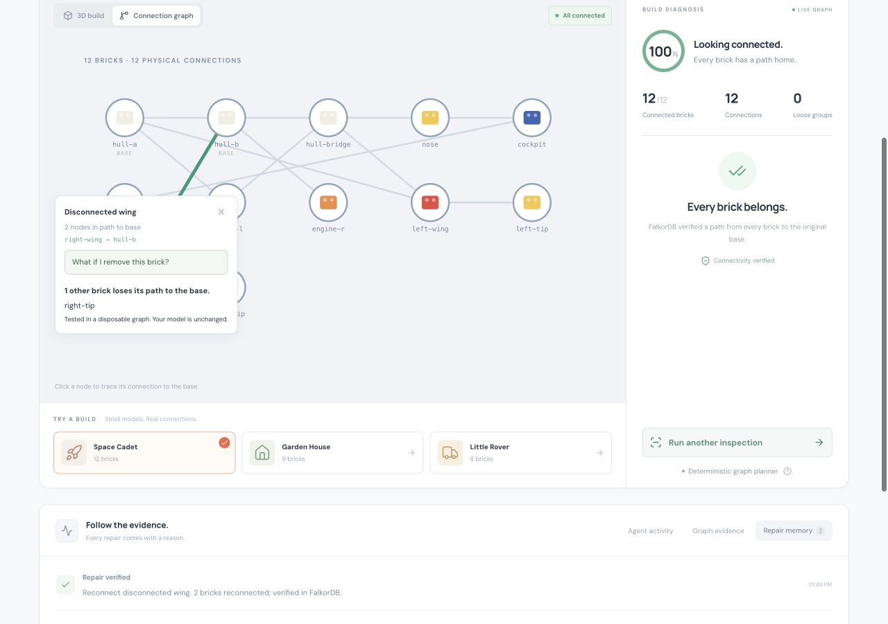
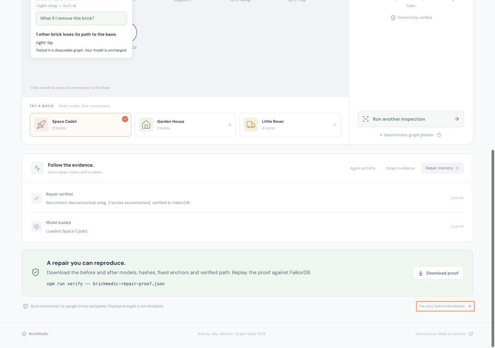
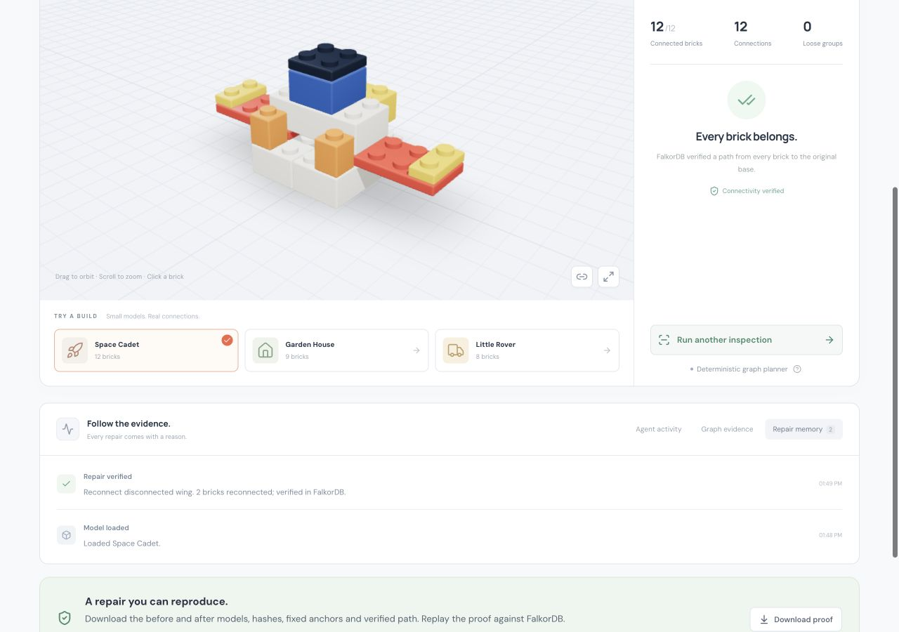

# Building BrickMedic with FalkorDB

_By Jake Johnson · October 17, 2026 · Built for Graph Hacks_

A small brick spaceship can look finished while its wing is floating a fraction of a brick above the hull. The interesting question is whether every piece has a chain of actual connections back to the base.

I built **BrickMedic** to make that question visible. It inspects a model, finds disconnected assemblies, proposes a translation, and verifies the repaired model in FalkorDB. You can orbit the build, preview the proposed placement, and follow the connection path behind the recommendation.


## Turning a brick model into a graph

My work on [BrickBuilder](https://github.com/jjohnson5253/brickbuilderai) made this a natural problem to explore. BrickMedic is a separate hackathon project, with a new FalkorDB implementation and a deliberately small geometry vocabulary: upright rectangular bricks and plates.

Each brick becomes a `Brick` node. A pair of bricks earns a connection when one brick's top meets the other's underside and their footprints overlap on the stud grid. Side contact alone does not count. Intersecting bricks fail validation.

The bricks on the base plane when the model is loaded become fixed anchors. Moving a loose piece onto the floor later does not turn it into a new anchor. That matters: the goal is to reconnect the assembly to the original build.

The central query asks which bricks can be reached from those anchors:

```cypher
MATCH (root:Brick {root: true})-[:CONNECTED*0..100]->(b:Brick)
RETURN DISTINCT b.id AS id
ORDER BY id
```

FalkorDB's directed shortest-path traversal led to one practical design choice: each physical stud connection is stored as two directed `CONNECTED` relationships. That lets a path travel up or down through an assembly. The interface counts each physical connection once.

Bricks absent from the reachable set are disconnected. A second traversal groups them into assemblies so a wing and its tip move together.

## Inspecting and testing a repair

The planner follows five steps:

1. Query the connection graph and identify loose assemblies.
2. Retrieve rejected placements remembered for the current revision.
3. Generate nearby translations that align stud faces, remain inside the model bounds, and introduce no collisions.
4. Build each shortlisted proposal in a temporary FalkorDB graph and query its connection paths.
5. Offer up to three verified repairs, ordered by assembly size, movement, and stud contacts.

The search is bounded: a translation can move up to eight studs on either horizontal axis and nine plate units vertically. It tests up to twelve shortlisted placements and stops after finding three valid options. A model may need a change outside that window; the interface says so when the search finds no repair.

For the spaceship demo, the preferred move shifts the two-brick wing assembly **one stud left and two plate units down**. That creates four stud contacts with the anchored build. A trial graph verifies a path from the wing tip, through the wing, to a base brick.

The green ghost in the viewer shows that proposed placement before it changes the model. Applying it triggers another server-side validation, updates the graph, and records the result. The spaceship goes from ten connected bricks out of twelve to twelve out of twelve.

## Giving AI a constrained decision

BrickMedic has two explicit modes. The default deterministic planner ranks the verified candidates without an API key. When an Anthropic key is configured on the server, an AI chooser selects a candidate and explains the choice.

The AI receives candidate IDs and verified evidence. It cannot submit arbitrary coordinates, execute Cypher, or bypass the geometry checks. The server rejects an ID outside the verified candidate list. A provider failure produces an error instead of silently presenting a deterministic result as an AI decision.

The adapter and failure boundaries were tested with controlled chooser implementations. A live Anthropic request was not run for this build. The screenshots show the deterministic graph planner.

## Remembering rejected placements

A valid connection can still be an undesirable design choice. The user can skip it, and BrickMedic stores the placement fingerprint in FalkorDB. Another inspection at that revision excludes the same placement, even after reconnecting to the app.

Plans and repair events also live in the graph. Each browser receives its own randomly named graph, keeping one visitor's model and proposals separate from another's. Model revisions prevent an old or repeated apply request from changing a newer build. Reloading a demo or importing a new model resets that model's repair memory.

## Letting an agent ask a better question

The second iteration adds a local MCP server built with the [official TypeScript SDK](https://ts.sdk.modelcontextprotocol.io/v2/). Its eight tools expose inspection, repair planning, removal simulation, memory, rejection and application. A compatible AI host can use those operations directly, while the server continues to own geometry validation and graph writes. Applying repairs is disabled until the owner enables it and should require approval in the host.

The question I like most is: **what else disconnects if I remove this brick?** BrickMedic copies the model into a trial graph, removes the selected node, and compares base reachability. In the repaired spaceship, removing the starboard wing strands its tip. The live build stays unchanged. The answer follows connection paths, including alternate routes, rather than assuming every piece above the removed brick falls away.

The MCP integration test also demonstrates a handoff. One client rejects a placement and closes. A fresh client reconnects to the same private session, recalls the rejection and current plan, then applies another verified repair. The memory survives because it lives in FalkorDB. This is a tested protocol workflow with scripted clients; it is not evidence that two autonomous language models collaborated. A separate container-replacement check confirmed that the model, active plan and rejection history survive replacing the database container, with append-only persistence in its named volume.



## A repair should carry its evidence

Every applied repair now writes a `Repair` node in the same Cypher operation as the updated model. It contains the before and after models, normalized SHA-256 hashes, original anchors, moved brick IDs, translation, revisions, connection counts and a verified path.

A download button makes that evidence portable. Running `npm run verify -- docs/evidence/repair-proof.json` checks the declared movement and reconstructs both states in fresh FalkorDB graphs. It verifies the counts and each path hop again. Tampering with a model, an anchor, a count or a path fails validation. The hashes bind the contents; they do not authenticate the author.



This gave the graph a second job beyond answering the initial question: it also makes the result reproducible outside the viewer.

## What the demo verified

The integration tests ran against a real local FalkorDB container. The three synthetic models exercise different disconnected assemblies:

| Model        | Bricks | Initially disconnected | Repairs applied | Connected afterward |
| ------------ | -----: | ---------------------: | --------------: | ------------------: |
| Space Cadet  |     12 |                      2 |               1 |                  12 |
| Garden House |      9 |                      4 |               1 |                   9 |
| Little Rover |      8 |                      4 |               2 |                   8 |

The larger evaluation adds 32 seeded generated tower models with varying assembly cuts, gaps and offsets. Across all **35 synthetic cases**, the deterministic planner repaired every model, preserved every original anchor, and produced **114 repair proofs that all passed independent replay**. The [JSON report](evidence/evaluation.json) includes every case and the seed. These are synthetic tests derived from a small geometry vocabulary, not a real-world or held-out benchmark.

The 44 tests also cover remembered rejections, reconnecting database and MCP clients, session isolation, concurrent repeated repairs, invalid inputs, proof tampering, removal impact, temporary-graph cleanup, and LDraw export. Geometry tests check the difference between a stud connection, a touching side, and an intersection.



## What I learned

The anchor definition is as important as the traversal. Treating every brick that reaches the floor as grounded would let the planner solve the wrong problem. Preserving the original anchor IDs makes a repair mean something specific.

The graph is also a useful boundary between a proposed action and an accepted result. A candidate has to survive a trial graph before it appears in the interface. The model is queried again after applying it. That makes the explanation inspectable: the user can see the exact sequence of bricks that reconnects the assembly.

Keeping the part catalog small made the geometry rules testable. BrickMedic verifies stud connectivity within that catalog. It does not simulate clutch strength, gravity, center of mass, building order, or the full LEGO parts system. Broader connector geometry would be the next substantial step.

## Run BrickMedic

The project is public and MIT licensed. It includes three synthetic demos, a 3D viewer, a connection graph, strict LDraw and JSON import, repaired-model export, and local setup instructions.

Start with the [BrickMedic repository](https://github.com/jjohnson5253/brickmedic). FalkorDB is required for inspection, proposal verification, model state, and repair memory; the app does not substitute an in-memory graph when the database is unavailable.

_AI assistance disclosure: Codex assisted with the implementation, tests, documentation, and this article. The submitted code and graph behavior require participant review and understanding, as specified in the [Graph Hacks rules](https://www.wemakedevs.org/hackathons/falkordb/rules)._
